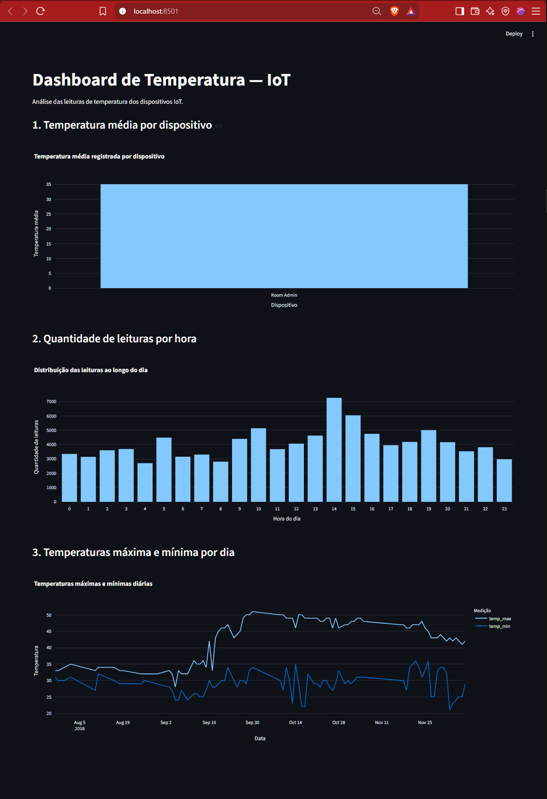

# Pipeline de Dados IoT com Docker, PostgreSQL e Streamlit

Projeto acadêmico desenvolvido para a disciplina **Disruptive Architectures: IoT, Big Data e IA**, com o objetivo de construir um pipeline de dados a partir de leituras de temperatura de dispositivos IoT.

O projeto utiliza Python para processar os dados, PostgreSQL para armazená-los, Docker para executar o banco de dados em um contêiner e Streamlit com Plotly para apresentar visualizações interativas.

## Objetivos do projeto

- Processar dados de temperatura provenientes de dispositivos IoT.
- Armazenar os dados estruturados em um banco PostgreSQL.
- Utilizar Docker para facilitar a execução do banco de dados.
- Criar consultas SQL por meio de views para análise dos dados.
- Desenvolver um dashboard interativo para visualizar os resultados.
- Documentar a instalação, a execução e as principais descobertas do projeto.

## Tecnologias utilizadas

- **Python:** processamento e integração dos dados.
- **Pandas:** leitura, limpeza e manipulação dos dados.
- **PostgreSQL:** armazenamento relacional.
- **Docker:** execução do banco de dados em contêiner.
- **SQL:** consultas e criação das views analíticas.
- **SQLAlchemy e psycopg2:** conexão e integração com o PostgreSQL.
- **Streamlit:** desenvolvimento do dashboard.
- **Plotly:** criação dos gráficos interativos.
- **Git e GitHub:** versionamento e hospedagem do código.

## Fonte dos dados

O projeto utiliza o dataset **Temperature Readings: IoT Devices**, disponibilizado no Kaggle.

Dataset: https://www.kaggle.com/datasets/atulanandjha/temperature-readings-iot-devices

Os dados contêm leituras de temperatura associadas a dispositivos e registros temporais. Eles são utilizados para explorar variações de temperatura, diferenças entre dispositivos e distribuição das leituras ao longo do dia.

## Estrutura do projeto

```text
pipeline-iot/
├── data/
│   └── IOT-temp.csv
├── docs/
│   └── dashboard.png
├── sql/
│   └── views.sql
├── src/
│   ├── processar_dados.py
│   └── dashboard.py
├── .gitignore
├── README.md
└── requirements.txt
```

- `data/IOT-temp.csv`: arquivo com os dados de origem.
- `src/processar_dados.py`: script de processamento e importação dos dados.
- `src/dashboard.py`: aplicação do dashboard interativo.
- `sql/views.sql`: definições das views SQL utilizadas nas análises.
- `docs/dashboard.png`: captura de tela do dashboard.
- `requirements.txt`: dependências Python do projeto.

## Pré-requisitos

Antes de executar o projeto, é necessário ter instalado:

- Python 3.10 ou superior.
- Docker Desktop.
- Git, caso deseje clonar o repositório.

O Docker Desktop deve estar aberto e funcionando antes de iniciar o banco de dados.

## Instalação e execução

### 1. Obter o projeto

Clone o repositório:

```bash
git clone https://github.com/GuILS00/pipeline-IOT.git
cd pipeline-IOT
```

Se o projeto já estiver na sua máquina, entre diretamente na pasta do projeto.

### 2. Criar o ambiente virtual

No Windows, utilizando PowerShell:

```powershell
python -m venv .venv
```

Ative o ambiente virtual:

```powershell
.\.venv\Scripts\Activate.ps1
```

Se o PowerShell bloquear a ativação, consulte as configurações de execução de scripts do Windows. Como alternativa, utilize o Prompt de Comando e execute:

```cmd
.venv\Scripts\activate.bat
```

### 3. Instalar as dependências

Com o ambiente virtual ativado, execute:

```bash
python -m pip install -r requirements.txt
```

### 4. Iniciar o PostgreSQL com Docker

O banco de dados é executado em um contêiner Docker.

Na configuração utilizada durante o desenvolvimento, os parâmetros são:

| Parâmetro | Valor |
|---|---|
| Contêiner | `postgres-iot` |
| Banco de dados | `iot_database` |
| Usuário | `iot_user` |
| Porta do host | `5433` |
| Porta interna do PostgreSQL | `5432` |

Se o contêiner já existir, inicie-o:

```bash
docker start postgres-iot
```

Verifique se está em execução:

```bash
docker ps
```

Caso o contêiner ainda não exista, crie-o com:

```bash
docker run --name postgres-iot -e POSTGRES_USER=iot_user -e POSTGRES_PASSWORD=SUA_SENHA -e POSTGRES_DB=iot_database -p 5433:5432 -d postgres
```

Substitua `SUA_SENHA` pela senha definida para o banco. Se o projeto já utiliza uma senha e um contêiner configurados, mantenha os valores existentes. Não crie outro contêiner desnecessariamente.

**Importante:** a senha do PostgreSQL deve corresponder à configuração de conexão utilizada pelo script Python. Para reproduzir o ambiente em outra máquina, ajuste as credenciais de acordo com a configuração local.

### 5. Processar e importar os dados

Confirme que o arquivo `data/IOT-temp.csv` está presente.

Execute o script:

```bash
python src/processar_dados.py
```

O script é responsável pelo processamento e pela importação dos dados para o PostgreSQL, conforme a configuração implementada no projeto.

Ao terminar, verifique as mensagens apresentadas no terminal e confirme que os dados foram carregados corretamente.

### 6. Criar as views SQL

As views utilizadas na análise estão definidas em `sql/views.sql`.

Para executar o arquivo no contêiner, utilize:

```bash
docker exec -i postgres-iot psql -U iot_user -d iot_database < sql/views.sql
```

Esse comando funciona no Prompt de Comando do Windows. Se estiver utilizando PowerShell e ocorrer algum problema com o redirecionamento, use:

```powershell
Get-Content .\sql\views.sql | docker exec -i postgres-iot psql -U iot_user -d iot_database
```

Se o PostgreSQL exigir senha, configure a autenticação conforme o ambiente utilizado.

### 7. Executar o dashboard

Com o banco de dados em execução, execute:

```bash
streamlit run src/dashboard.py
```

O Streamlit apresentará no terminal um endereço local, normalmente:

```text
http://localhost:8501
```

Abra esse endereço no navegador para visualizar e interagir com os gráficos.

## Dashboard

O dashboard foi desenvolvido com Streamlit e Plotly para facilitar a exploração dos dados de temperatura.

As visualizações permitem examinar os dados por diferentes perspectivas e apoiar a interpretação dos registros armazenados no banco.

### Captura de tela




## Views SQL

O projeto possui três views para facilitar a análise dos registros.

### 1. `avg_temp_por_dispositivo`

Calcula a temperatura média registrada para cada dispositivo.

**Objetivo:** permitir a comparação das médias entre os dispositivos e identificar possíveis diferenças nos registros.

### 2. `leituras_por_hora`

Conta a quantidade de leituras agrupadas por hora do dia.

**Objetivo:** identificar os horários com maior e menor concentração de registros e compreender a distribuição temporal dos dados.

### 3. `temp_max_min_por_dia`

Calcula as temperaturas máxima e mínima registradas em cada dia.

**Objetivo:** facilitar a observação da amplitude das temperaturas diárias e apoiar a identificação de variações ao longo do período analisado.

## Resultados observados

Durante a execução de desenvolvimento, foram observados os seguintes resultados:

- O arquivo de origem continha aproximadamente **97,6 mil registros**.
- A importação registrou **97.605 registros únicos**, com um registro duplicado ignorado pela lógica de importação utilizada.
- A média de temperatura associada ao dispositivo `Room Admin` ficou em torno de **35,05**, conforme os dados e a consulta executados.
- A distribuição das leituras apresentou o maior volume às **14 horas**, com **7.248 registros**, na análise realizada.

Esses valores correspondem à execução de desenvolvimento e podem variar se o dataset, os filtros, as regras de deduplicação ou o processamento forem alterados.

Os valores de temperatura devem ser interpretados de acordo com as características e a unidade efetivamente representadas pelo dataset original.

## Aplicações práticas

Uma solução desse tipo pode servir como base para:

- Monitoramento de temperatura em ambientes internos.
- Acompanhamento de sensores em instalações industriais.
- Identificação de períodos com maior concentração de leituras.
- Comparação de registros entre dispositivos.
- Construção de sistemas de monitoramento e análise de dados IoT.

O projeto é uma demonstração acadêmica de integração entre ingestão de dados, armazenamento, consultas analíticas e visualização. Ele não deve ser considerado, sem validações adicionais, um sistema de monitoramento industrial pronto para produção.

## Possíveis melhorias futuras

- Automatizar a execução periódica da ingestão.
- Implementar validações adicionais para dados ausentes ou inconsistentes.
- Externalizar credenciais utilizando variáveis de ambiente.
- Adicionar testes automatizados para o processamento.
- Criar alertas para temperaturas fora de limites configuráveis.
- Ampliar as análises e incluir indicadores adicionais no dashboard.

## Autor

Projeto acadêmico desenvolvido como atividade da disciplina **Disruptive Architectures: IoT, Big Data e IA**.

Repositório: https://github.com/GuILS00/pipeline-IOT